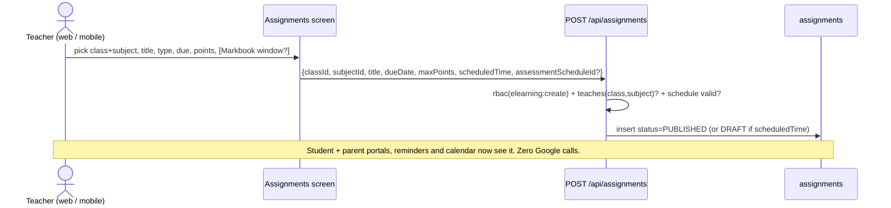
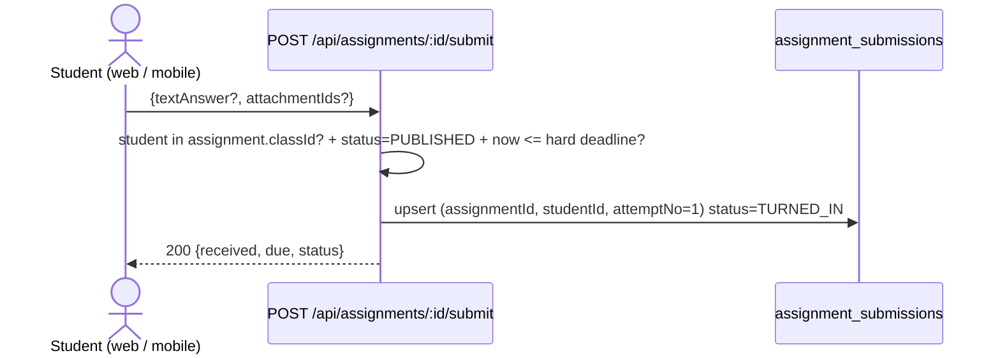
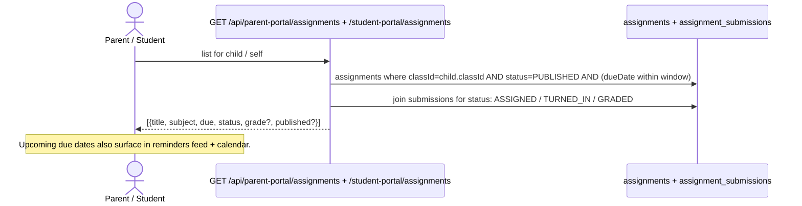

# Design: Native assignments + Google Classroom read-sync (survive on our own)

Status: **native slice built (2026-11-06).** Implemented on `feat/native-assignments`: written/file/both modes, S3-or-local file uploads, structured quizzes (single/multi choice, short/long text, file questions) with server-side auto-marking, question bank, timed attempts, teacher workspace page, student assignment page, and mobile screens. The Google Classroom read-sync (PR-1) remains a proposal. Points marked **DECIDE** still need answers for that phase. Verified facts were checked against the code on 2026-11-06.

## 1. Problem

Msingi can run a school without Google (Markbook, attendance, finance, messaging, live Zoom/Meet sessions) — Verified: `server/routes/assessment.js` has no Google dependency, PMI sessions (`POST /api/elearning/sessions`) never call `_getToken`.

But the one loop that is Google-locked is **"student submits work online → grade lands in the Markbook"**:

- Coursework create/list/delete, Drive upload, and submission reads all 403 `Google Classroom not connected` without per-teacher OAuth (`_getToken`, `server/routes/elearning.js`, 11 call sites) — Verified 2026-11-06.
- Grade back-sync is Pub/Sub push-only (`POST /gc-webhook`); no poll fallback, no "sync now" — Verified.
- Students are matched only by `Users.googleId`; a student who never signed in with Google gets no grade (webhook returns 204 silently) — Verified `elearning.js:601`.
- Coursework without `assessmentScheduleId` never reaches the Markbook; the skip is only a server `console.warn` — Verified.
- Synced marks are written `isPublished: true` immediately, bypassing the report-card publish flow — Verified `elearning.js:655`.
- Parent/student portals have **zero** coursework routes; students see `meetingLink` only on timetable slots (`student-portal.js:241`) — Verified. The mobile staff E-Learning screen is a placeholder stub — Verified (`ELearningScreen.tsx:109`).
- Reminders (`GET /api/assessment/reminders`) read only `assessment_schedule`; GC due dates never create reminders — Verified.

Goal: **one assignments surface that works with or without Google**, with GC as an optional source, never a requirement.

## 2. Principles

1. **Single write rule for grades.** Every grade (typed by a teacher, pushed from GC, or submitted natively) goes through one pure planner — generalize `planClassroomMark` (`server/utils/classroom-mark-plan.js`) to `planGradeWrite()` and reuse its tests. Silent skips become visible reasons.
2. **Mirror metadata + grades, never submission binaries.** File contents stay in Google Drive (GC) or Msingi object storage (native). We store links + hashes, not copies of children's work. (Kenya Data Protection Act — less exposure, no double retention.)
3. **Idempotent sync.** Every upsert keyed on `(schoolId, gcCourseWorkId)` / `(schoolId, assignmentId, studentId, attemptNo)`. A re-delivered webhook or re-run poll is a no-op (webhook already always-204s so Google never retries — re-delivery safety matters more now).
4. **Deterministic mapping only.** Keep `planClassroomMark`'s rule: no inferred periods, no auto-created students/classes. Unmapped items become a visible exception list for admin resolution.
5. **RBAC + tenant enforcement from day one.** `tenantModel`/`tenantContext` on every collection, `rbac('elearning', action)` on every route, plan gate `core` (extend `server/config/moduleRegistry.js` eLearning subs rather than inventing a new module — DECIDE 1). The RBAC Coverage + Tenant Enforcement CI gates must stay green.
6. **Backward compatible.** Existing GC-only schools see no change except richer visibility; existing Markbook data untouched.

## 3. Data model (single `assignments` collection, `source` discriminator)

```
assignments {
  id, schoolId, classId, streamId?, subjectId,
  source:            'native' | 'google_classroom',
  type:              'ASSIGNMENT' | 'SHORT_ANSWER_QUESTION' | 'MULTIPLE_CHOICE_QUESTION' | 'MATERIAL',
  title, description,
  status:            'DRAFT' | 'PUBLISHED',
  maxPoints, dueDate, dueTime, scheduledTime,
  assessmentScheduleId: string | null,      // Markbook window this work feeds (may be none)
  // GC source fields (null when native)
  gcCourseId, gcCourseWorkId, gcCourseWorkTitle, gcDriveFileId?, gcStudentIds?, // assignee scope
  // Native source fields
  attachmentIds: [message_attachments ids], answerKey?: [...], // MCQs — Phase 3 only
  createdBy, createdAt, updatedAt
}

assignment_submissions {
  id, schoolId, assignmentId, studentId, classId, subjectId,
  source, gcSubmissionId?, attemptNo,           // attemptNo = 1 always until resubmission policy exists (DECIDE 3)
  textAnswer: string | null,
  attachmentIds: [...],                          // native files; GC = Drive link references only
  status: 'ASSIGNED' | 'TURNED_IN' | 'GRADED' | 'RETURNED',
  submittedAt, gradedAt,
  assignedGrade: number | null,                  // GC points OR teacher-entered
  rawScore: number | null,                       // normalized 0–100, feeds assessment_marks
  markWriteStatus: 'PENDING' | 'WRITTEN' | 'SKIPPED', skipReason: string | null
}

assignment_sync_exceptions {   // the visible "admin resolution" list
  id, schoolId, kind: 'UNMAPPED_STUDENT' | 'NO_MARKBOOK_TARGET' | 'LOCKED' | 'NO_MAX_SCORE' | ...,
  assignmentId, studentId?, gcSubmissionId?, detail, createdAt, resolvedAt?, resolvedBy?
}
```

Indexes to add in `server/utils/indexes.js` (same shape as `assessment_marks` / `message_attachments` entries): `assignments` unique `(schoolId,id)` + `(schoolId,classId,subjectId,dueDate)`; `assignment_submissions` unique `(schoolId,assignmentId,studentId,attemptNo)` + `(schoolId,gcSubmissionId)` sparse; `assignment_sync_exceptions (schoolId, resolvedAt)`.

File storage follows the native precedent — `message_attachments` docs with per-recipient access checks (`GET /api/messages/attachments/:id`), not GC's teacher-Drive links. DECIDE 2: object store (S3-compatible) vs GridFS in Mongo. Recommendation: reuse whatever powers `fee_receipts`/attachments today; upload as base64 JSON like `POST /elearning/drive/upload` did, to avoid a new transport.

## 4. Workflow sketches

### 4.1 Teacher creates an assignment — native (no Google needed)



### 4.2 Student submits — native



### 4.3 Google Classroom — read-sync into Msingi (the visibility fix)

```mermaid
sequenceDiagram
  actor T as Teacher in Google Classroom
  participant GC as Google Classroom
  participant PUB as Pub/Sub push
  participant API as POST /api/elearning/gc-webhook (existing)
  participant SYNC as sync worker (new: poll + "Sync now")
  participant DB as assignments / assignment_submissions
  T->>GC: create coursework / student submits / teacher grades
  GC->>PUB: courseWork + studentSubmission event
  PUB->>API: webhook (existing, always 204)
  API->>DB: mirror coursework -> assignments (source=google_classroom, upsert on gcCourseWorkId)
  API->>DB: mirror submission -> assignment_submissions (googleId -> student; record exception if unmapped)
  SYNC->>GC: hourly poll for connected courses (fallback if Pub/Sub missing)
  Note over DB: Portals, calendar, reminders and trends now read the mirror — no GC call at read time.
```

### 4.4 Grade reaches the Markbook — one planner for all three sources

```mermaid
flowchart TD
  A[Grade arrives:<br/>typed | GC webhook | GC poll | native teacher-grade] --> B{planGradeWrite}
  B -->|schedule link missing| X1[SKIP: no_markbook_target<br/>-> sync exception]
  B -->|course class/subject missing| X2[SKIP: no_course_link]
  B -->|student not in course class| X3[SKIP: student_not_in_course_class]
  B -->|schedule locked / mark locked / under review| X4[SKIP: locked or under_review]
  B -->|all checks pass| W[upsert assessment_marks<br/>rawScore 0-100, markState=present<br/>isPublished=false*]
  W --> P{Publish flow}
  P -->|office publishes report| R[parent / student portal sees grade]
  P -->|not published| H[parent sees "submitted / awaiting publish"]
  X1 & X2 & X3 & X4 --> E[assignment_sync_exceptions list for teacher/admin]
```

\* DECIDE 4: synced grades enter as *unpublished* drafts and the existing publish flow promotes them (recommended — closes the current `isPublished: true` bypass). Until DECIDE 4 is answered, keep current immediate-publish behavior behind a school setting so nobody is surprised.

### 4.5 Parent/student visibility (the payoff)



## 5. API contracts

| Method | Route | Auth / gate | Body (key fields) | Response |
|---|---|---|---|---|
| POST | `/api/assignments` | `elearning:create`, teaches(class,subject) | title, classId, subjectId, type, dueDate, maxPoints, assessmentScheduleId?, attachments? | assignment doc |
| GET | `/api/assignments?classId&subjectId` | `elearning:read` (scoped) | — | list with submitted/graded counts |
| GET | `/api/assignments/:id` | read (scoped) | — | detail |
| PATCH | `/api/assignments/:id` | `elearning:update` | title/due/maxPoints/status | updated doc |
| DELETE | `/api/assignments/:id` | `elearning:delete` | — | 204 (also deletes mirror link row) |
| POST | `/api/assignments/:id/submit` | student self | textAnswer?, attachmentIds? | submission doc |
| POST | `/api/assignments/:id/grade` | `elearning:update`, teaches | studentId, assignedGrade, feedback? | planGradeWrite result |
| GET | `/api/assignments/:id/submissions` | `elearning:read` (scoped) | — | submissions list |
| POST | `/api/elearning/gc-webhook` | existing (always 204) | Pub/Sub push | mirror upserts + mark write |
| POST | `/api/elearning/sync` (new) | `elearning:update` | gcCourseId? | {mirrored, exceptions, skipped} |
| GET | `/api/parent-portal/assignments` (new) | parent self | childId | upcoming + graded (publish-gated) |
| GET | `/api/student-portal/assignments` (new) | student self | — | assigned + own submissions |
| GET | `/api/assessment/reminders` (extend) | existing | merge assignment due dates | combined list |

Mobile mirrors the web contract through `src/api/endpoints.ts` (`elearningApi`) — **one client service change per endpoint**, no raw fetch in screens (service-layer rule). Mobile replaces the `ELearningScreen` placeholder with lists; submission (native) comes in the mobile PR.

## 6. RBAC / plan gates

- Reuse module key `elearning` (core plan, `server/middleware/plan.js: elearning: 'core'`) — DECIDE 1 to confirm no new module/plan entitlement needed.
- Teacher writes scoped by teaching assignment (same 403 shape as marks bulk entry: "You are not assigned to teach: X").
- Students/parents: self-scoped only (child linkage), like `parent-portal`/`student-portal` conventions.
- Every new collection created via `tenantModel(..., tenantContext(req))`; add to tenant-enforcement test fixtures.

## 7. UI changes

**Web (client/):** extend `ELearningPage.jsx` — Classroom tab stays; add "Assignments" tab (native create modal modeled on `CreateCourseworkModal`, submissions/grades table modeled on `GradesTab`); exceptions panel (from `assignment_sync_exceptions`); "Sync now" button + last-sync timestamp. Routes: `/elearning`, `/elearning/classroom`, `/elearning/sessions` unchanged; new `/elearning/assignments` anchor (App.jsx already special-cases `/elearning/*` paths).

**Mobile:** replace `ELearningScreen` placeholder copy with real lists via `elearningApi`; add submit screen in the mobile PR.

**Portals:** parent dashboard "Assignments" card (due soon / submitted / graded with publish-gating label); student view mirrors it; due dates into reminders/calendar (events `online_class` precedent shows the calendar already accepts linked records).

## 7b. UX sketches (wireframes)

### Route map

```
Web  /elearning
      ├── Classroom          (existing — GC connect, course link, classwork)
      ├── Assignments   NEW  (native + mirrored GC in one list)
      │     ├── Assignment detail → Submissions → Grade
      │     └── Exceptions   (unmapped student / locked / no Markbook target)
      └── Online Sessions    (existing — PMI Zoom/Meet)

Mobile (staff)  eLearning → [Assignments] [Sessions]      (replaces placeholder)
Mobile (student) Assignments → detail → submit            (new)
Parent portal    Dashboard → "Assignments" card           (new)
Student portal   "Assignments" list                       (new)
```

### Teacher — Assignments tab (web)

```
┌─ eLearning ──────────────────────────────────────────────────────────────┐
│  Classroom   [ Assignments ]   Online Sessions                            │
├───────────────────────────────────────────────────────────────────────────┤
│  [ + New assignment ]                          Class ▾   Subject ▾   🔍    │
│                                                                           │
│  ┌─────────────────────────────────────────────────────────────────────┐  │
│  │ ● Fractions worksheet        NATIVE   Due Fri 13 Nov    ▓▓▓░ 18/24  │  │
│  │   Mathematics · Form 1A      PUBLISHED  · 12 graded   [ submissions ]│  │
│  ├─────────────────────────────────────────────────────────────────────┤  │
│  │ ● Week 3 quiz                GC       Due Mon 9 Nov     ▓▓▓▓ 24/24  │  │
│  │   Mathematics · Form 1A      PUBLISHED  · 24 graded   [ submissions ]│  │
│  ├─────────────────────────────────────────────────────────────────────┤  │
│  │ ● Revision notes             GC       —                MATERIAL      │  │
│  └─────────────────────────────────────────────────────────────────────┘  │
│                                                                           │
│  ⚠ 2 grades couldn't sync  ·  Review exceptions →                         │
└───────────────────────────────────────────────────────────────────────────┘
```

`NATIVE` / `GC` is the only visual difference — both rows behave identically.

### Create assignment (modal)

```
┌─ New assignment ──────────────────────────────────────────────── ✕ ─┐
│  Type      [ Assignment ][ Question ][ Material ]                    │
│  Title *   [ Fractions worksheet                                  ]  │
│  Instructions [ Share your working for Q1–Q5.                     ]  │
│  Class *   [ Form 1A ▾ ]        Subject * [ Mathematics ▾ ]          │
│  Due       [ 2026-11-13 ]  [ 23:59 ]     Points [ 20 ]               │
│  Publish   [ now ▾ ]  ·  or pick a datetime                          │
│  Feeds Markbook   [ HW · Term 3 · instance 1 ▾ ]   (optional)        │
│  Attachment       [ + Upload ]  → stored in Msingi, not Drive        │
│                                          [ Cancel ]  [ Create ]      │
└──────────────────────────────────────────────────────────────────────┘
```

### Submissions & grading

```
┌─ Fractions worksheet · Form 1A · Mathematics ──────────────────────────┐
│ Due Fri 13 Nov 23:59 · 20 pts · Feeds Markbook: HW · Term 3 · #1       │
│ Submitted 18/24 · Graded 12/24            [ Sync now ]   [ Export ]    │
├────────────────────────────────────────────────────────────────────────┤
│ Student          Status       Submitted       Answer / File    Grade   │
│ Achieng, M.      TURNED_IN    12 Nov 14:02    [ view ]         [ 16 ]  │
│ Baraka, J.       ASSIGNED     —               —                —       │
│ Chebet, L.       GRADED       11 Nov 09:10    [ view ]         18/20   │
│ ...                                                                    │
│                                            [ Save all grades ]         │
└────────────────────────────────────────────────────────────────────────┘
```

Saving writes through `planGradeWrite` → `assessment_marks` (unpublished) and shows the reason inline if it skips (e.g. `schedule locked`).

### Exceptions panel

```
┌─ Sync exceptions ──────────────────────────────────────────────────────┐
│ ⚠ Grace W. — Google account not linked to a Msingi student   [ map ]   │
│ ⚠ Week 4 quiz — no Markbook window selected                  [ link ]  │
│ ⚠ Lab report — Mid-Term window is locked                     [ view ]  │
└────────────────────────────────────────────────────────────────────────┘
```

### Student portal / mobile

```
┌─ Assignments ──────────────────────────────────────────┐
│  Due soon                                              │
│  ┌───────────────────────────────────────────────────┐ │
│  │ Mathematics · Fractions worksheet                 │ │
│  │ Due Fri 13 Nov · 20 pts          [ Open → ]       │ │
│  └───────────────────────────────────────────────────┘ │
│  Submitted                                             │
│  ┌───────────────────────────────────────────────────┐ │
│  │ Mathematics · Week 3 quiz                         │ │
│  │ ✅ Submitted 9 Nov · 18/20                        │ │
│  └───────────────────────────────────────────────────┘ │
└─────────────────────────────────────────────────────────┘

┌─ Fractions worksheet ──────────────────────┐
│ Due Fri 13 Nov · 20 pts                    │
│ Instructions: Share your working Q1–Q5.    │
│                                            │
│ Your answer                                │
│ ┌────────────────────────────────────────┐ │
│ │ Type your answer…                      │ │
│ └────────────────────────────────────────┘ │
│ [ + Add photo / file ]                     │
│                                            │
│ [ Submit ]        one attempt              │
└────────────────────────────────────────────┘
```

### Parent portal

```
┌─ Assignments · Mary Achieng ───────────────────────────┐
│  Due this week                                         │
│  Mathematics · Fractions worksheet                     │
│  Due Fri 13 Nov                    ⏳ Not submitted    │
│                                                        │
│  Recently graded                                       │
│  Mathematics · Week 3 quiz                             │
│  18/20 · graded 9 Nov              ✅ Submitted        │
│  "Grade is released when the school publishes the term"│
└────────────────────────────────────────────────────────┘
```

### End-to-end swimlane

```
TEACHER              MSINGI                          STUDENT/PARENT        GOOGLE
  │                    │                                  │                  │
  │ create assignment  │                                  │                  │
  ├───────────────────▶│ assignments (PUBLISHED)          │                  │
  │                    ├──────── card + due reminder ────▶│                  │
  │                    │                                  │                  │
  │  NATIVE PATH       │◀──────────── submit ─────────────┤                  │
  │◀── grading queue ──┤ assignment_submissions           │                  │
  │  grade 16/20       │                                  │                  │
  ├───────────────────▶│ planGradeWrite → assessment_marks│                  │
  │                    ├──────── publish flow ───────────▶│ sees 16/20       │
  │                    │                                  │                  │
  │  GC PATH           │                                  │   teacher grades │
  │                    │◀───── webhook / hourly poll ─────┼──────────────────┤
  │                    │ mirror + planGradeWrite          │                  │
  │                    ├──────── status / grade ─────────▶│                  │
```

### State machines

```
assignment:  DRAFT ──publish──▶ PUBLISHED ──(due passes)──▶ CLOSED (derived, not stored)

submission:  ASSIGNED ──submit──▶ TURNED_IN ──grade──▶ GRADED ──return──▶ RETURNED
                  ▲                   │                  │
                  └── teacher reopen ─┴── resubmit (only if DECIDE 3 allows) ◀┘
```

## 8. Rollout (PRs, each squash-merged via gh, CI gates green)

1. **PR-1 — Mirror + portals (smallest useful slice):** `assignments` + `assignment_submissions` + exceptions collections, indexes, webhook mirroring, poll worker (`server/jobs/` — check `ADR-0006` job-queue convention), `POST /sync`, parent/student assignments endpoints + web cards. GC stays submission surface. *Acceptance:* with Pub/Sub disabled, "Sync now" mirrors coursework; unmapped students appear in exceptions, not silently dropped.
2. **PR-2 — Native teacher + student web:** CRUD, submit, grade-through-planner, exceptions resolution UI. Idempotency + auth tests (class teacher can see all, subject teacher 403s off-subject, parent self-scope).
3. **PR-3 — Publish flow + reminders + mobile:** synced/native grades obey publish gates (DECIDE 4), due-date reminders merge, mobile screens + demo fixtures + full E2E (playwright on `/elearning/assignments` + emulator pass).
4. **PR-4 (optional) — Quiz engine:** MCQ question bank, in-app timed attempt, auto-grading into `rawScore` — the true "online exam" mode. Gated on DECIDE 5 (attempt limits, randomization, negative marking).

## 9. Test plan

Unit: planner (`classroom-mark-plan.test.js` generalized), sync idempotency (same webhook twice → one row), RBAC scoping (subject vs class teacher), publish gating. Integration: webhook→mirror→mark→portal round-trip with fake GC fixtures; Pub/Sub-absent poll path; `npm test` + the 4 CI gates (Unit & Integration, Dangerous Pattern, RBAC Coverage, Tenant Enforcement). API contract first per `api-test-first`: curl the new endpoints against local API before writing the client service.

## 10. Non-goals

Copying submission binaries (see principle 2); replacing Google Classroom for GC-native schools (import path only); Zoom API sessions (PMI flow already covers live).

## 12. Uploads, deadlines and 100-student concurrency

**Today (honest):** assignment submissions hold `textAnswer` only. `attachmentIds` exists on the model but there is no upload endpoint, no storage bucket and no file picker — nothing is stored for assignments. Two existing patterns must not be copied:

- `message_attachments` stores base64 blobs **inside MongoDB**, behind the global `express.json({ limit: '10mb' })`. That is fine for a report card sent to one parent; it is the wrong shape for 100 students × files (DB growth, 10 MB cap, whole file buffered in Node).
- `backupStorage.js` already talks to S3-compatible storage (AWS S3 / R2 / B2 / MinIO) via `@aws-sdk/client-s3`, but only for encrypted backups.

**Target design — direct-to-storage, metadata in Mongo:**

```
Student → POST /api/assignments/:id/attachments/presign {fileName,mimeType,size}
            server checks: enrolment, published, school-time deadline/allowLate,
            size ≤ 10 MB, count ≤ 5, MIME allowlist
        ← { uploadUrl (presigned PUT, 5 min), objectKey, attachmentId }
Student → PUT uploadUrl  (bytes go straight to the bucket, never through Node)
Student → POST /:id/submit { textAnswer?, attachmentIds }
            server HEADs each object, verifies size/type, writes assignment_attachments
Teacher/Parent → GET /api/assignments/:id/attachments/:attId
            access check (teaching scope / student self / parent child)
            ← 302 to a 60-second presigned GET (or a CDN URL)
```

- **Key layout:** `schools/{schoolId}/assignments/{assignmentId}/{studentId}/{uuid}-{safeName}` — per-tenant, per-assignment, per-student. An orphan sweep can list a prefix and delete anything older than 24 h with no metadata row.
- **Safety:** MIME allowlist (pdf, png/jpg, docx), extension check, `Content-Disposition: attachment`, async virus scan before a teacher opens it, no inline execution.
- **Retention:** lifecycle rule keeps objects for the term + N days; deleting an assignment/student cascades metadata and enqueues object deletion.

**100 students at once.** Concurrency is ~400 small operations, not 100 file streams:

| Step | Load at 100 students | Where it runs |
|---|---|---|
| Presign | 100 × ~1 KB JSON | Node (stateless, ~ms each) |
| Upload | 100 × ≤10 MB PUTs | Object storage, in parallel |
| Submit | 100 × single upsert | Mongo, unique `(schoolId,assignmentId,studentId,attemptNo)` |
| Read-back | 100 × signed GET | CDN/object storage; Node only signs |

The app server never buffers a file, so memory stays flat; the 10 MB JSON limit is irrelevant because bytes bypass it. The only shared hot spot is the Mongo upsert, and the unique index makes retries idempotent. For a whole class downloading the same worksheet, a CDN caches the object — reads scale independently of the API.

**Deadlines.** Server-authoritative, no client clock trust:

- `dueDate`/`dueTime` are wall-clock values in the **school's** timezone (`schools.timezone`), converted with `server/utils/school-deadline.js`; a missing time means 23:59 local.
- Enforced at **presign and submit** (the file cannot be uploaded after the bell, even if the form was already open).
- `allowLate` is an explicit per-assignment switch (web + mobile create forms).
- One attempt while `TURNED_IN`; after `GRADED` a resubmit is refused until the teacher reopens (reopen endpoint/UI is a follow-up).
- A late file already in the bucket is harmless: without a submission row pointing at it, the orphan sweep removes it.

## 13. Answer modes and question types (proposal)

**Today:** one free-text answer per student. The `type` field accepts `ASSIGNMENT | SHORT_ANSWER_QUESTION | MULTIPLE_CHOICE_QUESTION | MATERIAL`, but only the free-text path is implemented and exposed (web offers Assignment / Question / Material; mobile offers Assignment). There is no file picker, no option set and no auto-grading. `MULTIPLE_CHOICE_QUESTION` is accepted by the API but would behave like a written answer — so the UI does not offer it.

### Answer modes (one per assignment)

| Mode | Student sees | Grading |
|---|---|---|
| `written` (today) | one text box | teacher |
| `file` | picker, up to N files | teacher |
| `both` | text box + picker | teacher |
| `quiz` | questions rendered one by one | MCQ auto, written/file by teacher |

### Data model for structured work

```
assignment_questions {
  id, schoolId, assignmentId, order,
  type: 'MCQ_SINGLE' | 'MCQ_MULTI' | 'SHORT_TEXT' | 'LONG_TEXT' | 'FILE',
  prompt, options: [{ id, text }],      // MCQ only
  correctOptionIds: [ ... ],            // server-only, never sent to a student
  points, required, wordLimit?, maxFiles?
}

assignment_answers {
  id, schoolId, assignmentId, studentId, questionId,
  selectedOptionIds: [], textAnswer, attachmentIds: [],
  awardedPoints, autoGraded: bool, gradedBy, gradedAt
}
```

A submission's total is the sum of its answers' `awardedPoints`; `assignment.maxPoints` must equal the sum of question points (validated at publish). Auto-grading writes `awardedPoints`; written/file answers stay `null` until the teacher marks them. The final total enters the Markbook through the same `planGradeWrite` path.

### Rules that matter

- **Never trust the client with answers.** `correctOptionIds` is stripped from every student-facing payload; grading runs on the server. A student cannot read the key from the assignment detail response.
- **One attempt by default.** Timed quizzes (startedAt / expiresAt, server clock) are a later flag; the deadline model already uses the school timezone.
- **Partial credit policy** for `MCQ_MULTI`: all-or-nothing or per-correct-option minus per-wrong-option — DECIDE.
- **Randomisation**: shuffle question order and/or options per student, then persist the shuffled order with the attempt so review matches what they saw.
- **Mixed assignments** are allowed (a quiz can end with a long-answer question); release per-question feedback only after the teacher publishes, matching the report-card gate.
- **Question bank** (reuse across assignments/terms) is a separate collection later; v1 embeds questions in the assignment.

### Workflow sketch

```
Teacher: choose mode [written | file | both | quiz]
   quiz → add questions (type, prompt, options, correct answer, points)
   publish → server validates Σpoints == maxPoints

Student: mode-specific screen
   written → text box            file → picker (presigned PUT)
   quiz    → one question at a time, answers saved server-side

Server: MCQ answers auto-scored immediately
        written/file answers queued for the teacher
        total → planGradeWrite → assessment_marks (unpublished)
Teacher: opens the submission, marks remaining answers, returns feedback
```

## 11. DECIDEs

1. **Module/plan:** reuse `elearning` + core plan, or new entitlement? (Recommend: reuse.)
2. **Native file storage:** S3-compatible, GridFS, or reuse existing attachment store? (Recommend: reuse existing attachment store.)
3. **Resubmission/attempts:** single attempt with teacher return, or N attempts? Live-online exam attempt limits belong here too.
4. **Publish flow for synced grades:** immediate (current) vs gated via existing publish flow? (Recommend: gated, default-off with a school setting.)
5. **Quiz engine scope:** in or out of PR-4? (MCQ auto-grade only, or open-ended with teacher marking?)
6. **Late submissions:** hard cutoff at dueDate, grace window, or teacher override? (Recommend: teacher can reopen after due date, like schedule unlock.)
7. **Demo data:** seed a second term's snapshots + a few native/GC assignments into the demo school so trends (PR-18) and this feature are demonstrable end-to-end?
8. **Answer modes:** which ship first — file upload, MCQ quiz, or both? (Recommend: file first; it is the most-requested classroom need and has no grading engine.)
9. **Multi-select scoring:** all-or-nothing, or partial credit with a wrong-option penalty?
10. **Timed quizzes:** server-enforced timer now, or keep to the existing due date until a later phase?
11. **Per-question feedback:** release after teacher returns the work, or only with the term report?
